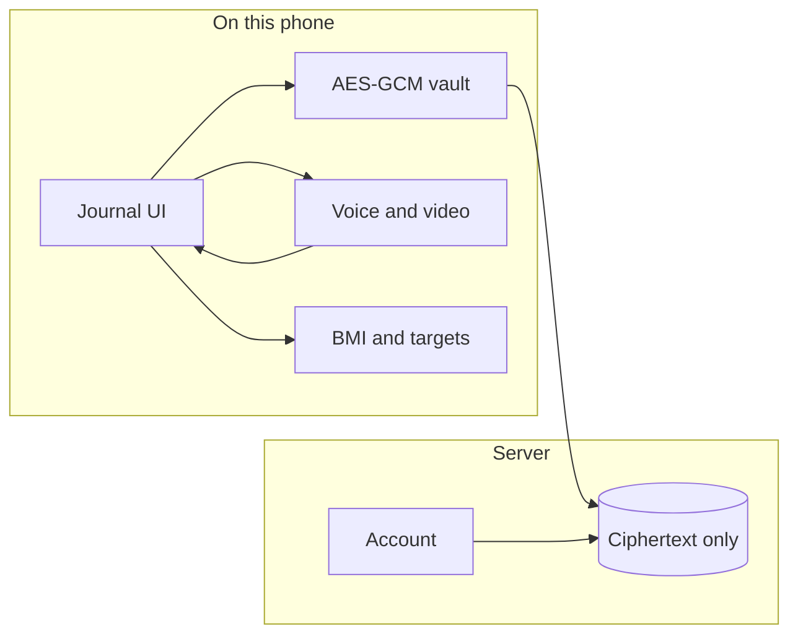

# Aahar

A private, phone-first journal for meals, movement, and a calmer way of eating.

Aahar keeps the record on your side of the lock. Meals are encrypted in the browser before they are saved. Voice and video stay on the device. The server stores ciphertext tied to your account, not a public feed of what you ate.

Built by [Aditya Agrahari](https://boss974829.github.io/) · [THE RULE](https://github.com/boss974829).

## Install the Android app

| | |
| --- | --- |
| Package | `com.aditya.aahar` |
| Version | 1.0.5 |
| File | [`releases/Aahar.apk`](releases/Aahar.apk) |
| Release | [v1.0.5](https://github.com/boss974829/aahar/releases/tag/v1.0.5) |

On the phone: download the APK, allow install from the browser, and open **Aahar**. The journal is inside the app. You do not paste a website. **Film** opens the phone camera for a short clip (about 12 seconds). **Estimate nutrients** fills the plate from what you wrote. **Transcribe clip** turns a voice clip into words. Height, meals, and the passphrase stay on that phone. Version 1.0.5 is the current build.

This build is debug-signed so it can be installed directly. It is not a Play Store listing.

## What you can do

- Sign in and get a private account id.
- Start from height and weight. BMI and a calorie guide are calculated on the device.
- Log a meal by typing, by speaking English or Hindi, or with a short video. Text and a clip can be used together.
- See calories and protein, carbs, and fat from the meal text.
- Keep a month of meals, movement, and weight, with charts.
- Read a short diet note based on BMI and the days you actually logged.
- Switch light and dark. Write to the developer from **You**.

## Map



## Modules

| Module | Feature | What it does | How |
| --- | --- | --- | --- |
| UI | Journal | Phone column, clear type, light and dark | React, Tailwind |
| Account | Unique id | Sign in. Data is scoped to that id | Better Auth |
| BMI | Height and weight | Score, band, and a daily kcal guide | On device |
| Logging | Audio | English and Hindi speech, plus typed text | Browser speech |
| Logging | Video | Short meal clip, kept on the phone | Camera |
| Nutrition | Calories and macros | Parsed from what you wrote, in English or Hindi | On device |
| History | One month | Meals, movement, weight, charts | Charts on device |
| Suggestions | Diet note | Written from BMI and recent logged days | Rules on device |
| Privacy | Encryption | Meals locked before they leave the phone | AES-GCM, passphrase |
| Contact | Developer | GitHub, landing page, and a note to Aditya | In **You** |

## Privacy

| Stays on the phone | Leaves the phone |
| --- | --- |
| Passphrase | Account sign-in |
| Voice and video clips | Meal text as ciphertext |
| The key that opens old meals | Nothing readable as a meal |

If the passphrase is forgotten, a new phone cannot open old meals. This phone still can.

## A day in the app

| Screen | What it is |
| --- | --- |
| Today | Greeting, calorie ring, macros, the meals you saved |
| Log | Type, speak, or film a meal. Add movement or weight |
| Month | The last month as charts |
| Plan | The diet note, from BMI and recent days |
| You | Body details, private id, developer and contact |

## Project

```
src/components/aahar   screens
src/lib/health.ts      BMI, targets, meal parser, diet note
src/lib/vault.ts       encryption
src/lib/foods.ts       foods the parser knows
src/lib/records.functions.ts   save and load ciphertext
migrations             database tables
android                Android shell that installs as an APK
releases/Aahar.apk     installable build
```

## Run it on a computer

```bash
npm install
npm run dev
```

Open `http://127.0.0.1:8080`.

| Script | |
| --- | --- |
| `npm run dev` | Local journal |
| `npm run build` | Production build |
| `npm run typecheck` | Types |
| `npm test` | Tests |

Set `DATABASE_URL` when you want Postgres instead of the local database. Do not commit secrets.

## Android

The phone app is a full-screen shell around the journal.

| | |
| --- | --- |
| Application id | `com.aditya.aahar` |
| Min Android | 7.0 |
| Source | `android/` |
| Output | `releases/Aahar.apk` |

Rebuild after changing the code:

```bash
cd android
./gradlew assembleDebug
cp app/build/outputs/apk/debug/app-debug.apk ../releases/Aahar.apk
```

You need JDK 17 and an Android SDK. `android/local.properties` should point `sdk.dir` at that SDK. That file is not committed.

## Developer

| | |
| --- | --- |
| Aditya Agrahari | [boss974829.github.io](https://boss974829.github.io/) |
| GitHub | [github.com/boss974829](https://github.com/boss974829) |
| Note | adityaagrahari9797@gmail.com |

Inside the journal: **You → Aditya Agrahari**.
